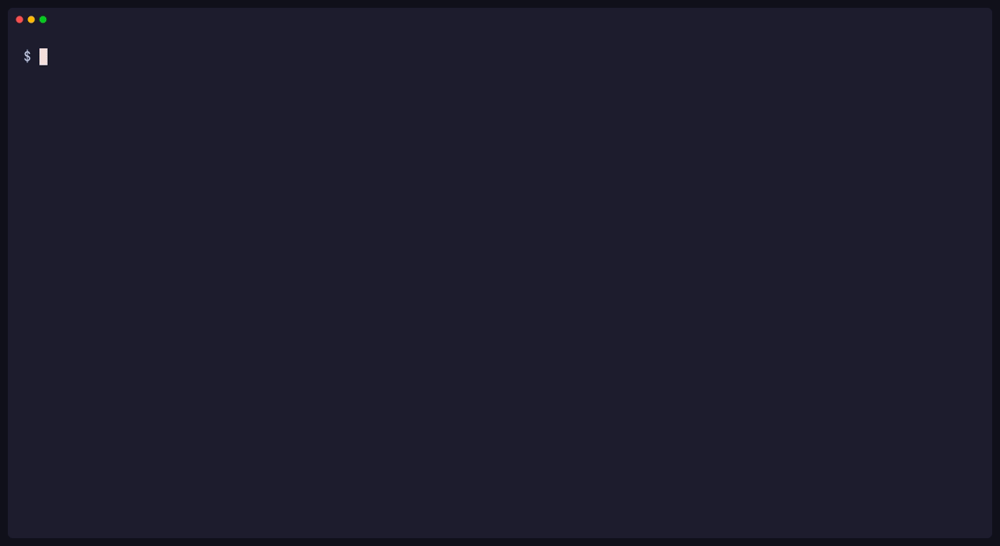

Install the seek skill, the instructions that teach a coding agent when and
how to run seek, from the seek binary you have. The skill comes with seek, so
it always matches the installed version.



## 1. Print the skill

```sh
seek skill
```

seek prints the skill as Markdown, starting with its name and description:

```text
---
name: seek
description: >-
  Use the `seek` CLI to search the web, run autonomous deep research, or scrape
```

## 2. Save it where your agent reads skills

Save the output as `SKILL.md` in a `seek` folder of your agent's skills
directory. For Claude Code, the user skills directory is `~/.claude/skills`:

```sh
mkdir -p ~/.claude/skills/seek
seek skill > ~/.claude/skills/seek/SKILL.md
```

For another agent, use the skills directory its documentation names.

## 3. Update it with seek

After you upgrade seek, run the same command again, so that the skill
describes the commands the new version has.

## Check the result

The saved file is the skill the binary prints:

```sh
seek skill | cmp - ~/.claude/skills/seek/SKILL.md && echo "up to date"
```

```text
up to date
```

The agent needs seek on its `PATH`, and provider keys or a seek server, as
for any other use; see [Set up provider keys](config.md).
