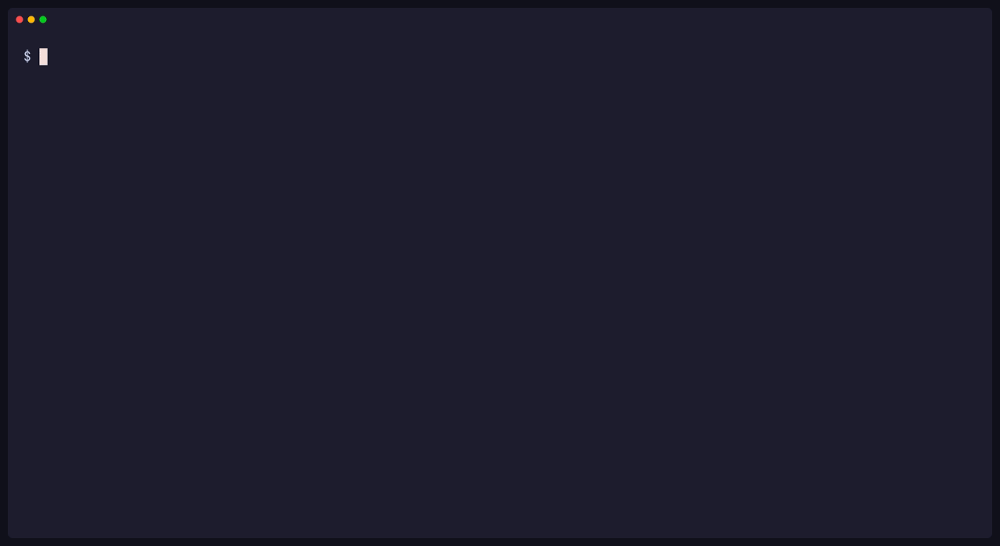

Point the CLI at a seek server, so that the server holds the provider keys
and this machine holds only the server's address and a client token. You need
the server's URL and a client token from whoever runs it (see
[Run a seek server](server.md)).
If your client uses the seek 0.3 configuration, see
[Upgrade from seek 0.3](upgrade-from-0-3.md).



## 1. Set the server and the token

Replace `<client-token>` with the token you were given:

```sh
export SEEK_SERVER_URL=https://seek.internal.example
export SEEK_SERVER_TOKEN_VALUE=<client-token>
```

To keep them, set `server.url` in the configuration file,
`~/.config/seek/client.yml`, and keep the token in a file of its own, read
with `server.token.file`:

```yaml
server:
  url: https://seek.internal.example
  token:
    file: ~/.config/seek/secrets/seek-client-token
```

A variable takes precedence over the file, and a flag such as `--server-url`
over both.

## 2. Or read the token from Vault or OpenBao

Name the field of a KV secret that holds the token, and the server and login
seek uses to read it, as in
[client-with-server.yml](examples/client-with-server.yml):

```yaml
server:
  url: https://seek.internal.example
  token:
    vault:
      path: clients/my-seek-cli
      key: SEEK_SERVER_TOKEN
vault:
  address: https://bao.internal.example
  auth:
    mode: token
    token:
      file: ~/.vault-token
```

seek reads the secret from the `secret` KV version 2 mount unless
`vault.mount` and `vault.kv-version` say otherwise, and also logs in with
AppRole (`mode: approle`, with `role-id` and `secret-id`). `BAO_ADDR` and
`VAULT_ADDR` set `vault.address`, and `BAO_TOKEN` and `VAULT_TOKEN` set a
token login, `BAO_*` before `VAULT_*`. A login is used only for the server it
was declared beside, so a token exported for another server never reaches
this one. If your shell exports `BAO_ADDR`, `BAO_TOKEN` or `BAO_NAMESPACE`
for another server, they override the file's top-level `vault` settings and
seek stops with an error that names both servers. Unset that whole set for
seek, or give the token's `vault` block its own `address`, `auth` and, when
the exported set has one, `namespace` (`""` for the root namespace), which no
variable overrides. seek reads Vault only when a command calls the server,
and a failed read stops the command.

## 3. Check the setup

```sh
seek config show
```

The `server.url` and `server.token` lines name the server and where the token
comes from:

```text
server.url = https://seek.internal.example  (env SEEK_SERVER_URL)
server.token = value <redacted>  (env SEEK_SERVER_TOKEN_VALUE)
```

Then run any command, such as
`seek web parallel "how do honeybees make honey"`. It prints results as it
does with a local key. In server mode the CLI does not use local provider
keys.

## If a command fails

- `HTTP 401` means the server did not accept the token.
- `HTTP 503` with `seek server has no API key configured for <provider>`
  means the server has no key for that provider. The message names the
  setting the server needs.

To go back to local keys, unset `SEEK_SERVER_URL` and remove `server.url`
from the configuration file. See [How seek finds keys and tokens](credentials.md)
for how seek chooses each source and the
[configuration reference](reference/configuration.md) for the client settings.
