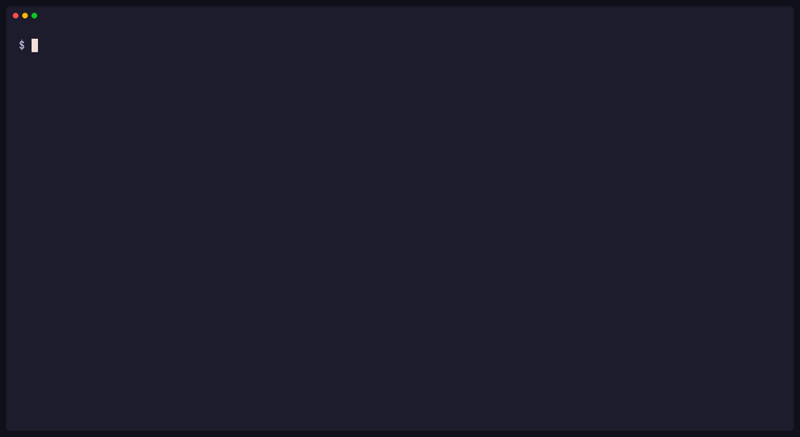

Get the text of pages whose URLs you already have, as Markdown, plain text or
JSON. You need the provider's key (see [Set up provider keys](config.md)) or
a seek server. The practice server from
[Run your first search](first-search.md) answers `seek scrape exa`, with
made-up text.



## 1. Pick the command

| You want | Command | Key |
| --- | --- | --- |
| The text of one or more pages, in bulk | `seek scrape exa` | `providers.exa.api-key` |
| Excerpts focused on an objective, with publish dates, from one or more pages | `seek scrape parallel` | `providers.parallel.api-key` |
| One page as Markdown, HTML, links, a summary, a screenshot or extracted JSON | `seek scrape firecrawl` | `providers.firecrawl.api-key` |

## 2. Extract the pages

Put the URLs after the command:

```sh
seek scrape exa https://example.com/honey
```

```text
# Practice page 1
https://example.com/honey

Made-up text for https://example.com/honey. The practice server wrote it and did not fetch the page.
```

Each page prints as a heading with its title, its URL and its text. Several
pages are separated by `---`.

## 3. Shape the result

```sh
seek scrape exa https://example.com/honey https://example.org/bees -c 2000
seek scrape parallel https://example.com/honey --objective "Find the harvest months"
seek scrape firecrawl https://example.com/honey -f markdown,links --wait 2000
```

- `-c` caps the characters per page for `exa`, and per excerpt for
  `parallel`.
- `--objective` focuses the `parallel` excerpts on a goal, and `--full` adds
  each page's full Markdown.
- `seek scrape firecrawl` takes one URL. `-f` chooses the formats Firecrawl
  returns, and seek prints the first it has, in this order: Markdown, summary,
  HTML, links, extracted JSON, screenshot. `--wait` gives the page's
  JavaScript time to run, and `--json-prompt` asks Firecrawl to extract JSON
  with the prompt you give.

The [scrape commands](reference/commands/seek-scrape.md) list every option.

## 4. Get JSON for a script or an agent

Add `--json` to print the provider's own response:

```sh
seek scrape exa https://example.com/honey --json
```

## Check the result

Each URL printed a block of text, and the command exited with status 0.
`seek scrape parallel` lists the URLs it could not read under `Errors:`
after the blocks it read.
