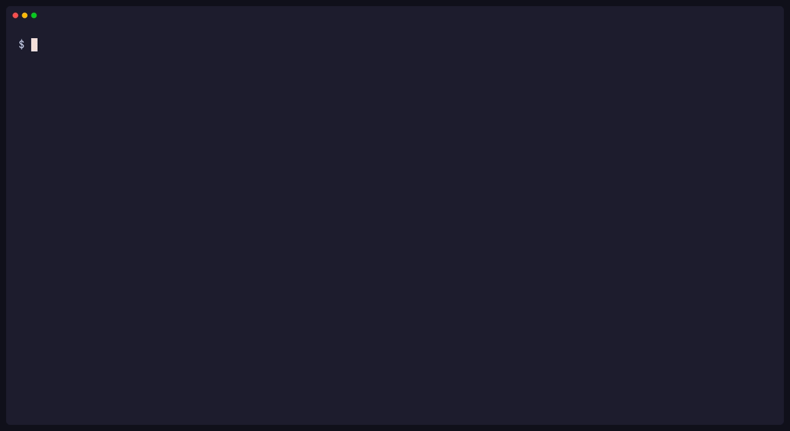

In this tutorial we write nothing from scratch: we run a small client that
calls a seek server's HTTP API, read what it prints, and then see the error
the server returns for a wrong token. We use the seek practice server, which
answers the same API with made-up results, so we need no provider key.

You need [Node.js](https://nodejs.org/) 18 or later. If you use
[Bun](https://bun.sh), substitute `bun` for `node` throughout. The examples
call the HTTP API directly, so you can run them without installing seek.



## Start the practice server

Download [practice-server.mjs](examples/practice-server.mjs) and
[server-client.mjs](examples/server-client.mjs) into an empty folder. In a
terminal in that folder, start the server:

```sh
node practice-server.mjs
```

```text
seek practice server listening on http://127.0.0.1:8788
client token: practice-token
```

Leave it running.

## Run the client

Open a second terminal in the same folder. The client reads the server's
address and the client token from the same variables the seek CLI uses:

```sh
export SEEK_SERVER_URL=http://127.0.0.1:8788
export SEEK_SERVER_TOKEN_VALUE=practice-token
node server-client.mjs "how do honeybees make honey"
```

```text
GET /healthz -> 200 {"status":"ok"}
POST /v1/proxy/exa/search -> 200
1. Practice result 1 for "how do honeybees make honey"
   https://example.com/practice/result-1
2. Practice result 2 for "how do honeybees make honey"
   https://example.com/practice/result-2
3. Practice result 3 for "how do honeybees make honey"
   https://example.com/practice/result-3
```

The client made two requests. The first, `GET /healthz`, needs no token and
answers `{"status":"ok"}` while the server runs; we can see it in
[health.response.json](examples/health.response.json). The second sent Exa's
own search request to `/v1/proxy/exa/search` with our token as
`Authorization: Bearer practice-token`. A real seek server adds its Exa key
and forwards the request to Exa, and the answer is Exa's own response: we read
`title` and `url` from each of its `results`.

Open `server-client.mjs` and find the two `fetch` calls: that is the whole
integration.

## Send a wrong token

Now we change the token and run the client again:

```sh
export SEEK_SERVER_TOKEN_VALUE=wrong-token
node server-client.mjs "how do honeybees make honey"
```

```text
GET /healthz -> 200 {"status":"ok"}
POST /v1/proxy/exa/search -> 401
error: missing or invalid seek server token
```

The health check still works, because it needs no token. The search returns
401, and the body is one of the seek server's own errors, a JSON object with
one `error` field, as in
[unauthorized.response.json](examples/unauthorized.response.json). The client
exits with status 1.

## Stop the practice server

Press Ctrl+C in the first terminal, and unset the variables in the second:

```sh
unset SEEK_SERVER_URL SEEK_SERVER_TOKEN_VALUE
```

## What we did

We called a seek server's health check and its Exa proxy route from code, read
the provider's response through it, and saw how the server rejects a token it
does not accept. The same client works against a real server: set
`SEEK_SERVER_URL` to the server and `SEEK_SERVER_TOKEN_VALUE` to a token it
accepts, and the results come from Exa.

Next:

- [How the seek server proxies provider calls](server-proxy.md) explains what
  the server changes and what it passes through.
- The [HTTP API reference](reference/http-api.md) lists every route seek uses,
  each response and the [OpenAPI definition](reference/http-api.openapi.yml).
- [Run a seek server](server.md) starts a real one.
