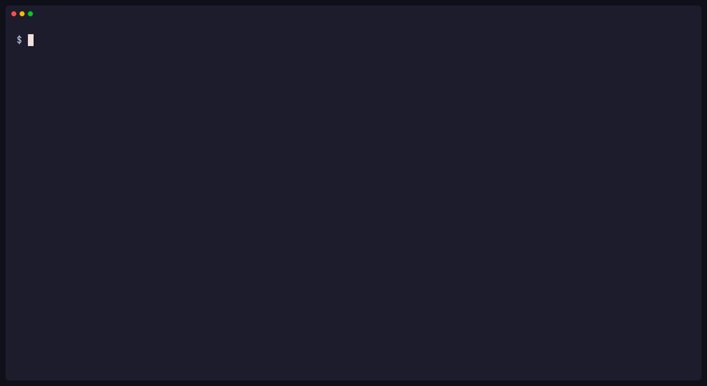

Run `seek serve`, or its container image, on a machine that holds the
provider keys, so that CLIs elsewhere call providers through it with a client
token. [How the seek server proxies provider calls](server-proxy.md) explains
what the server does with each request.
If you already run seek 0.3, see
[Upgrade from seek 0.3](upgrade-from-0-3.md).



## 1. Choose a client token

Clients send this token with every request. Generate one:

```sh
openssl rand -hex 32
```

To rotate tokens without downtime, give the server a comma-separated list,
such as `<new-token>,<old-token>`, then remove the old one when no client
uses it.

## 2. Give the server its keys

The server reads its own configuration, `/etc/seek/server.yml`, or the file
that `--config` or `SEEK_CONFIG` names; then its environment variables; then
its flags. The client tokens are the setting `server.tokens`, and each
provider key is `providers.<provider>.api-key`. Each names one source: the
secret itself, a file, a credential helper, or a field of a Vault or OpenBao
KV secret. Use whichever you keep secrets in:

- **Environment:** set the derived variables. Replace the example values with
  your secrets.

  ```sh
  export SEEK_SERVER_TOKENS_VALUE='<client-token>'
  export SEEK_PROVIDERS_EXA_API_KEY_VALUE='<exa-api-key>'
  ```
- **Files:** point each setting at a file that holds the secret, such as a
  container secret mount or a systemd credential, in `/etc/seek/server.yml`:

  ```yaml
  server:
    tokens:
      file: /run/secrets/seek-client-tokens
  providers:
    exa:
      api-key:
        file: /run/secrets/exa-api-key
  ```
- **Vault or OpenBao:** store the keys as fields of a KV secret, then name
  each field. This example uses an OpenBao CLI already authenticated to write
  to the secret path:

  ```sh
  bao kv put secret/seek EXA_API_KEY='<exa-api-key>' SEEK_SERVER_TOKENS='<client-token>'
  ```

  and logs the server in with AppRole, as in
  [server.yml](examples/server.yml):

  ```yaml
  server:
    host: 0.0.0.0
    tokens:
      vault:
        path: seek
        key: SEEK_SERVER_TOKENS
  providers:
    exa:
      api-key:
        vault:
          path: seek
          key: EXA_API_KEY
  vault:
    address: https://bao.internal.example
    auth:
      mode: approle
      role-id: <role-id>
      secret-id:
        file: /run/secrets/seek-secret-id
  ```

  The server also logs in with a token (`mode: token`, with `token: { file:
  ... }` for a Vault Agent that rotates it) or with none (`mode: none`, for an
  agent socket such as `unix:///run/openbao/agent.sock`). `BAO_ADDR` or
  `VAULT_ADDR` sets `vault.address`, and `BAO_TOKEN` or `VAULT_TOKEN` a token
  login. For a private certificate authority, set `vault.ca-cert` to its
  bundle, or add it to `NODE_EXTRA_CA_CERTS`, `SSL_CERT_FILE` or
  `SSL_CERT_DIR`; seek reads them when it starts, so a change takes effect at
  the next restart. To reach Vault through a proxy, set `vault.proxy` to its
  `http://host:port`; seek ignores `HTTP_PROXY` and the other proxy variables
  for Vault.

The server reads every secret before it starts and stops if one fails. It
reads each again after `server.secret-refresh-seconds`, 300 unless you set
it, and keeps the value it has when a later read fails. Check the
configuration without reading any secret:

```sh
seek config validate --server
seek config show --server
```

The [configuration reference](reference/configuration.md) lists every
setting. [How seek finds keys and tokens](credentials.md) explains how the
server chooses a secret source.

## 3. Start the server

```sh
seek serve --host 0.0.0.0 --port 8787
```

```text
seek serve: listening on http://0.0.0.0:8787
seek serve: providers with keys: exa
```

The server binds `127.0.0.1:8787` unless `server.host` and `server.port`, as
`SEEK_SERVER_HOST`, `SEEK_SERVER_PORT`, `--host` and `--port`, say otherwise.
It does not start without a client token unless `server.require-token` is
false (`--no-auth`), which only a trusted network should use. It logs each
request on stderr, without keys or tokens.

The server speaks plain HTTP. Put it behind TLS, such as a reverse proxy, an
ingress or a service mesh, whenever clients reach it over a network.

## Or run the container image

The image `ghcr.io/wyrd-company/seek-server` runs `seek serve` for
`linux/amd64` and `linux/arm64`, tagged with each release version. It binds
`0.0.0.0:8787`, runs as a non-root user and reads `/etc/seek/server.yml`
when you mount one there.

```sh
docker run --rm -p 8787:8787 \
  -e SEEK_SERVER_TOKENS_VALUE='<client-token>' \
  -e SEEK_PROVIDERS_EXA_API_KEY_VALUE='<exa-api-key>' \
  ghcr.io/wyrd-company/seek-server:latest
```

With a configuration file, mount it and its secrets:

```sh
docker run --rm -p 8787:8787 \
  -v "$PWD/server.yml:/etc/seek/server.yml:ro" \
  -v "$PWD/secrets:/run/secrets:ro" \
  ghcr.io/wyrd-company/seek-server:latest
```

## Check that it works

From a client machine:

```sh
curl -s 'http://<server-host>:8787/healthz'
```

```text
{"status":"ok"}
```

Then point a CLI at it, as [Use a seek server from the CLI](connect-to-a-server.md)
describes. To call it from your own code, follow
[Call a seek server from your code](server-client.md). A request for a
provider the server has no key for returns HTTP 503 and names the setting
to configure.
